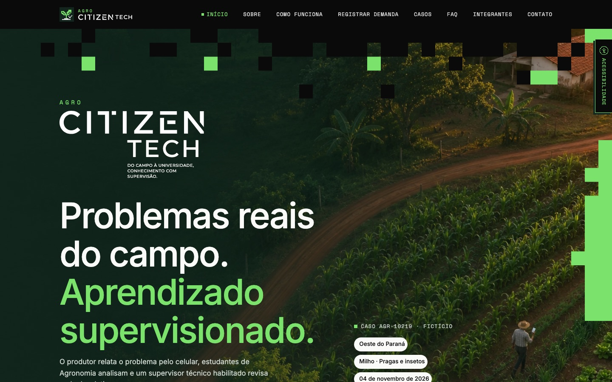
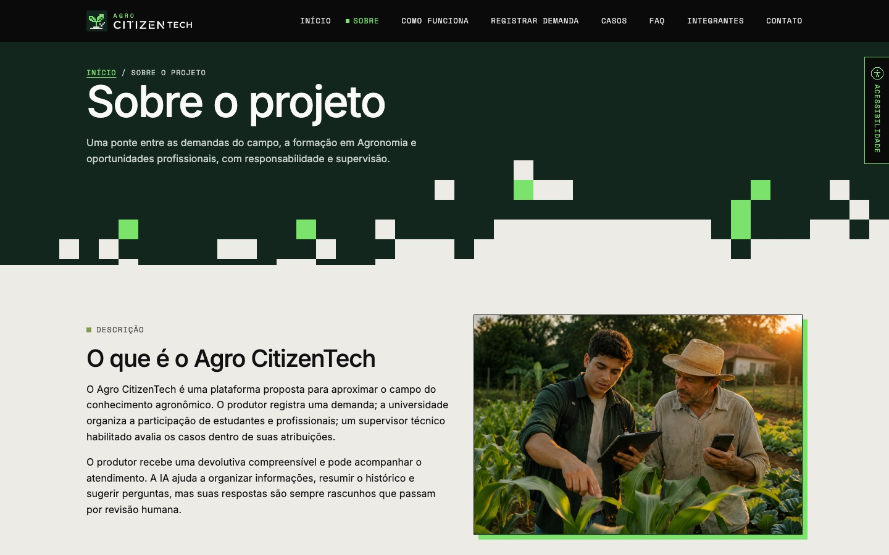
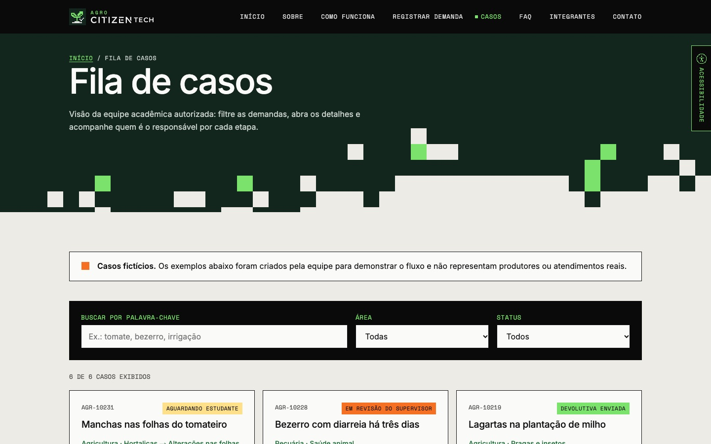

# 🌱 Agro CitizenTech

> Problemas reais do campo. Aprendizado supervisionado. Experiências que abrem portas.

Projeto da **Global Solution 2026/2 — FIAP** (tema *CitizenTech*), disciplina **Front-End Design Engineering**.

## Descrição

**Problema:** pequenos produtores rurais têm dificuldade para acessar orientação técnica adequada ao seu contexto, organizar as informações da propriedade e manter acompanhamento. Ao mesmo tempo, estudantes de Agronomia têm poucas oportunidades de prática supervisionada e com registro confiável.

**Solução:** o Agro CitizenTech é uma plataforma que conecta pequenos produtores a estudantes e profissionais de Agronomia, universidades e supervisores técnicos. O produtor registra a demanda pelo celular, uma ficha de triagem organiza o relato (com apoio consultivo de IA), estudantes preparam a devolutiva e um supervisor habilitado revisa antes de qualquer orientação chegar ao produtor.

Este repositório contém o **site/protótipo navegável** da solução, com casos fictícios. Não há atendimento real nem envio de dados a servidores.

## Tecnologias utilizadas

| Tecnologia | Uso |
| --- | --- |
| HTML5 | Estrutura semântica das páginas (`header`, `nav`, `main`, `section`, `article`, `aside`, `footer`) |
| CSS3 | Identidade visual, layout com Flexbox/Grid e responsividade com Media Queries (mobile-first) |
| JavaScript (puro) | Menu mobile, validação de formulário, acordeão, abas, triagem de demanda, filtro e modal de casos, animação ao rolar e menu de acessibilidade |
| Git / GitHub | Versionamento e colaboração da equipe |
| Google Fonts | Inter (textos), Space Mono (rótulos) e Montserrat (assinatura "TECH") |
| Canvas API | Mosaico de pixels da identidade visual (`js/pixels.js`) |

Nenhum framework ou biblioteca front-end foi utilizado. Os ícones e o logo são SVGs em pixel art desenhados numa grade 16×16; as fotos do site foram geradas com IA (ver [Uso de IA generativa](#uso-de-ia-generativa)).

### Identidade visual

Inspirada na página oficial da [Global Solution CitizenTech](https://experience.fiap.com.br/global-solution-citizen-tech): blocos quadrados ("pixels") que corroem as bordas das seções, verde neon sobre verde-escuro, títulos grandes em fonte grotesca e rótulos monoespaçados. A assinatura **CITIZEN TECH** e o logo **FIAP global solution** foram extraídos da página oficial do evento (`assets/icons/citizen.svg` e `assets/icons/fiap-global-solution.svg`).

## Páginas

| Página | Conteúdo |
| --- | --- |
| `index.html` | Identificação da solução, resumo e acesso às principais áreas |
| `sobre.html` | Descrição, problema, objetivo, proposta e ODS |
| `como-funciona.html` | Jornadas por perfil em **abas** (produtor, estudante, supervisor, IA) |
| `registrar-demanda.html` | **Solução 1:** formulário de demanda com ficha de triagem gerada em tempo real e rascunho salvo no navegador |
| `casos.html` | **Solução 2:** fila de casos com **filtro** por palavra, área e status, e **modal** de detalhes |
| `faq.html` | Perguntas frequentes em **acordeão** |
| `integrantes.html` | Dados da equipe |
| `contato.html` | Formulário de contato com **validação em JavaScript** |

## Interações em JavaScript

1. **Menu mobile (hambúrguer):** abre e fecha, fecha com `Esc` e ao clicar em um link (`js/script.js`).
2. **Validação do formulário de contato:** campos obrigatórios, formato de e-mail, mensagens de erro por campo e mensagem de sucesso (`js/contato.js`).
3. **Acordeão** no FAQ e **abas** em Como funciona, com navegação por teclado (`js/script.js`).
4. **Triagem da demanda:** classifica o relato por palavras-chave, identifica a suspeita do produtor, lista as informações faltantes e salva o rascunho no `localStorage` (`js/triagem.js`).
5. **Fila de casos:** renderização dinâmica, filtros combinados e modal com histórico e ação "Manifestar interesse" (`js/casos.js`).
6. **Mosaico de pixels:** desenha em `<canvas>` os blocos das bordas, com animação de entrada, destaque do bloco sob o mouse e redesenho ao redimensionar; respeita a opção "Reduzir animações" (`js/pixels.js`).
7. **Animação ao rolar:** com `IntersectionObserver`, títulos, cards e blocos sobem e aparecem quando entram na tela, em cascata nas grades. Sem JavaScript, ou com "Reduzir animações", o conteúdo aparece normalmente (`js/script.js`).
8. **Menu de acessibilidade:** aba fixa na borda da tela que encolhe para só o ícone ao rolar e abre ao passar o mouse, com clique ou com o teclado (`js/acessibilidade.js`).

## Acessibilidade

- **Menu de acessibilidade** em todas as páginas, com três opções salvas no navegador:
  - **Reduzir animações:** desliga o mosaico animado, a animação ao rolar e as transições.
  - **Aumentar texto:** aumenta todos os textos do site.
  - **Alto contraste:** textos secundários mais escuros, bordas fortes e links sublinhados.
  - Sem escolha salva, o site segue as preferências do sistema (`prefers-reduced-motion` e `prefers-contrast`).
- **Navegação por teclado:** link "Pular para o conteúdo" e o menu de acessibilidade são os dois primeiros itens do Tab; foco visível em laranja em todos os elementos; menu mobile, modal e painel de acessibilidade fecham com `Esc` e devolvem o foco; abas navegáveis pelas setas.
- **Leitores de tela:** HTML semântico, `alt` nas imagens, `label` em todos os campos, `aria-expanded`, `aria-controls`, `role="switch"` e mensagens de formulário com `aria-live`.

## Estrutura de pastas

```
global_citizentech/
├── index.html
├── sobre.html
├── como-funciona.html
├── registrar-demanda.html     # página da solução 1
├── casos.html                 # página da solução 2
├── faq.html
├── integrantes.html
├── contato.html
├── README.md
├── integrantes.txt            # RM, nome completo e turma (exigido na entrega)
├── css/
│   └── style.css              # estilos globais, componentes e media queries
├── js/
│   ├── script.js              # comum: menu mobile, acordeão, abas, animação ao rolar
│   ├── contato.js             # validação do formulário de contato
│   ├── triagem.js             # ficha de triagem da demanda
│   ├── casos.js               # fila de casos: filtro e modal
│   ├── pixels.js              # mosaico de pixels da identidade visual
│   └── acessibilidade.js      # menu de acessibilidade (carregado no <head>)
└── assets/
    ├── images/                # fotos do site, fotos dos integrantes e screenshots/
    └── icons/                 # logo e ícones SVG em pixel art
```

## Como executar

Acesse o site publicado em https://ryanjeimysson.github.io/agro-citizentech/ ou abra o `index.html` no navegador. Não é preciso instalar nada.

## Imagens do projeto

**Página inicial**



**Sobre o projeto**



**Fila de casos (página da solução)**



## Autores

| Nome completo | RM | Turma | GitHub | LinkedIn |
| --- | --- | --- | --- | --- |
| Renato Dagnolo Rodrigues | 574993 | 1TDSPA-26 | [redagnolo](https://github.com/redagnolo) | [LinkedIn](https://www.linkedin.com/in/redagnolo/) |
| Lucas Gabriel Scomparin | 575112 | 1TDSPA-26 | [LucScomparin](https://github.com/LucScomparin) | [LinkedIn](https://www.linkedin.com/in/lucas-scomparin/) |
| Ryan Jeimysson Matos de Jesus | 575552 | 1TDSPA-26 | [ryanjeimysson](https://github.com/ryanjeimysson) | [LinkedIn](https://www.linkedin.com/in/ryanjeimysson/) |
| Laura de Lucena Ferres | 576007 | 1TDSPA-26 | [LauraLFerres](https://github.com/LauraLFerres) | [LinkedIn](https://www.linkedin.com/in/laura-ferres/) |
| Diego Amador Limachi Aguilar | 574630 | 1TDSPA-26 | [amadordiego168-source](https://github.com/amadordiego168-source) | [LinkedIn](https://www.linkedin.com/in/diego-amador-limachi-aguilar-895291435/) |

## Repositório e site

- Repositório: https://github.com/ryanjeimysson/agro-citizentech
- Site publicado (GitHub Pages): https://ryanjeimysson.github.io/agro-citizentech/

## Contato

- Pelo formulário da página [Contato](contato.html) do site.
- Pelo LinkedIn ou GitHub de qualquer integrante (links na tabela [Autores](#autores)).

## Uso de IA generativa

Conforme as regras da Global Solution, declaramos as ferramentas de IA usadas como apoio:

| Ferramenta | Uso |
| --- | --- |
| Claude | Auxílio para tirar dúvidas, explicar erros e revisar trechos de código e do README |
| ChatGPT (geração de imagens) | Fotos do site e referência visual do logo e dos ícones, que depois redesenhamos em SVG |

O desenvolvimento, as decisões de projeto e a revisão final foram feitos pela equipe, que entende e consegue explicar todo o código entregue.

## Referências

- IBGE. Censo Agropecuário 2017.
- Lei nº 11.788/2008 (Lei do Estágio) e Lei nº 13.709/2018 (LGPD).
- ONU. Objetivos de Desenvolvimento Sustentável 2, 4, 8 e 17.
